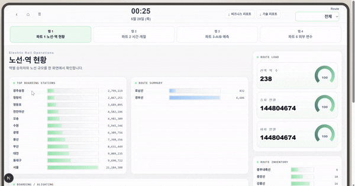

# VACANT

KTX 노선별 공실률을 분석하고, 향후 공실 위험과 초과수요 구간을 예측해 좌석 운영 의사결정을 돕는 데이터 기반 플랫폼입니다.

이 프로젝트는 2026 국토교통 데이터 활용 경진대회 제품·서비스 개발 분야 제출을 목표로 제작되었습니다.

## 시연 화면



## 프로젝트 한눈에 보기

- 문제: 노선·시기별 좌석 수요 편차가 커서 어떤 구간은 공실이 많고, 어떤 구간은 입석 수준의 초과수요가 반복됩니다.
- 목표: KTX 공실률 패턴을 시계열과 설명 변수 관점에서 함께 분석해 운영자가 증편, 좌석 재배분, 프로모션 여부를 판단할 근거를 제공합니다.
- 결과물: 분석 파이프라인, 예측 모델, SHAP 해석, FastAPI, Next.js 대시보드, 리포트 다운로드 기능을 하나의 저장소로 통합했습니다.

## 왜 이 문제를 풀었는가

철도 운영에서는 단순 승객 수만 보는 것으로는 부족합니다. 같은 노선이라도 월별, 계절별, 코로나 시기, 명절 구간, SRT 개통 이후 구조 변화에 따라 좌석 운영 전략이 달라져야 합니다.

이 프로젝트는 다음 질문에 답하는 것을 목표로 합니다.

> 어느 노선·시기·외부 조건에서 빈 좌석이 많이 발생하는가,  
> 그리고 어디에서 초과수요가 반복되는가?

## 해결 방식

VACANT는 세 층으로 문제를 다룹니다.

1. 현황 진단  
   역별 승하차와 노선별 규모를 집계해 수요 집중 구간을 확인합니다.

2. 공실률 예측  
   CatBoost 회귀 모델과 Prophet 시계열 모델을 사용해 향후 공실률 변동을 추정합니다.

3. 의사결정 해석  
   SHAP, 공휴일 변수, 노선별 비교 결과를 통해 왜 그런 예측이 나왔는지 설명합니다.

## 사용 데이터

주요 데이터 출처는 다음과 같습니다.

- 한국철도공사 고속철도 여객 수송 동향
- 한국철도공사 월별 여객수송 실적
- 한국철도공사 KTX 역별 승하차 데이터
- KTX 구간별 통계 데이터
- 한국천문연구원 특일 정보 API

현재 저장소 기준 분석 범위는 다음과 같습니다.

- 노선·역 현황 집계: 7개 노선
  - 강릉선, 경부선, 경전선, 전라선, 중부내륙선, 중앙선, 호남선
- 월별 공실률 예측: 5개 노선
  - 경부선, 호남선, 경전선, 전라선, 동해선

근거: [REPORT_DATA_ANALYSIS_SUMMARY.md](REPORT_DATA_ANALYSIS_SUMMARY.md)

## 핵심 분석 결과

현재 문서와 산출물 기준으로 확인되는 주요 결과는 다음과 같습니다.

- 호남선 평균 공실률은 34.3%로 가장 높아 공실 관리 필요성이 크게 나타났습니다.
- 경부선 평균 공실률은 10.7% 수준으로 상대적으로 낮았습니다.
- 2023년 이후 일부 노선은 이용률 100% 초과 구간이 반복되어 초과수요 신호가 확인됐습니다.
- CatBoost 통합 모델의 평균 MAE는 약 6.9959%p입니다.
- month 단위 walk-forward 검증 기준 평균 MAE는 7.2850%p입니다.
- SHAP 분석에서는 전월 공실률, 3개월 이동평균, 코로나기간, 전년 동월 공실률의 영향이 크게 나타났습니다.
- Prophet은 추세 비교용 기준선으로는 유용하지만 최근 초과수요 구간은 충분히 따라가지 못했습니다.

위 수치는 [REPORT_DATA_ANALYSIS_SUMMARY.md](REPORT_DATA_ANALYSIS_SUMMARY.md)와 현재 저장소 산출물을 바탕으로 정리했습니다.

## 대시보드 구성

현재 대시보드는 4개 탭으로 구성되어 있습니다.

1. 파트 1 노선·역 현황  
   역별 승하차, 노선 규모, 노선별 역 구성 확인

2. 파트 2 시간·계절 패턴  
   월별 공실률 패턴, 최근 추세, 명절 변수 비교

3. 파트 3-A/B 예측  
   CatBoost 회귀 모델과 Prophet 시계열 예측 결과 비교

4. 파트 5 외부 변수  
   공휴일, 명절, 코로나기간, 노선별 SHAP 영향도 해석

현재 UI 구현 파일:
- [dashboard/components/Dashboard.jsx](dashboard/components/Dashboard.jsx)

## 대표 산출물

대표 이미지:
- [boxplot_season.png](outputs/img/boxplot_season.png)
- [trend_yearly.png](outputs/img/trend_yearly.png)
- [month_pred_vs_actual.png](outputs/img/month_pred_vs_actual.png)
- [part4_prophet_forecast.png](outputs/img/part4_prophet_forecast.png)
- [shap_summary.png](outputs/img/shap_summary.png)

주요 CSV 산출물:
- `data/processed/ktx_long.csv`
- `data/processed/ktx_model_input.csv`
- `data/processed/month_split_metrics.csv`
- `data/processed/model_comparison_per_route.csv`
- `data/processed/shap_per_route.csv`
- `data/processed/part4_prophet_forecast.csv`
- `data/processed/part4_prophet_metrics.csv`

## 기대 효과

이 프로젝트가 제공하려는 실제 활용 가치는 다음과 같습니다.

- 공실이 많은 노선·시기에 할인, 프로모션, 탄력 편성 검토
- 초과수요가 반복되는 노선에 임시 증편 또는 좌석 공급 재배분 검토
- 명절, 연휴, 코로나 같은 외부 충격을 운영 판단에 반영
- 담당자가 숫자만 보는 것이 아니라 대시보드와 해석 결과로 빠르게 상황을 파악

## 기술 구성

저장소는 분석 코드, API, 대시보드가 함께 있는 단일 프로젝트 구조입니다.

```text
gyotong/
├── api/                     FastAPI 서버
├── assets/fonts/            대시보드 폰트
├── dashboard/               Next.js 16 대시보드
├── data/
│   ├── raw/                 원본 데이터
│   └── processed/           분석/예측 결과 CSV
├── docs/                    참고 문서
├── models/                  학습된 CatBoost 모델
├── notebooks/               분석 노트북
├── outputs/
│   ├── img/                 PNG 시각화 결과
│   └── reports/             생성 리포트 출력 경로
└── src/                     분석 파이프라인 코드
```

주요 코드:

```text
src/
├── config.py               경로, 컬럼명, 모델 설정
├── preprocess_ktx.py       KTX 원본 전처리
├── features.py             피처 엔지니어링
├── holiday_analysis.py     공휴일 변수 생성
├── part1_aggregate.py      역별 승하차 / 노선 요약 집계
├── model.py                CatBoost 기반 메인 회귀 모델
├── model_month_split.py    month 단위 walk-forward 검증
├── Per_route_model.py      노선별 개별 모델 비교
├── prophet_model.py        Prophet 예측 및 평가 저장
├── shap_analysis.py        SHAP 중요도 산출
├── llm_report.py           요약 리포트 생성
├── report_generator.py     비즈니스/기술 PDF 생성
└── dashboard_static.html   정적 대시보드 대안 페이지
```

## 실행 방법

실행 환경:
- Python 3.11+
- Node.js 20+ 권장
- 현재 작업 기준 가상환경: `skn25`

패키지 설치:

```bash
pip install -r requirements.txt
cd dashboard
npm install
```

환경 변수:

```bash
cp .env.sample .env
```

주요 변수:

| 변수 | 기본값 | 설명 |
|------|--------|------|
| `LLM_MODEL` | `gpt-4o-mini` | Part 6 리포트 생성 모델 |
| `OPENAI_API_KEY` | 없음 | OpenAI API 키 |

분석 파이프라인 예시:

```bash
python -m src.preprocess_ktx
python -m src.features
python -m src.holiday_analysis
python -m src.part1_aggregate
python -m src.model
python -m src.model_month_split
python -m src.Per_route_model
python -m src.prophet_model
python -m src.shap_analysis
python -m src.llm_report
python -m src.report_generator
```

주의:
- `data/raw/`는 수정하지 않습니다.
- 일부 스크립트는 기존 `data/processed/*.csv`를 갱신합니다.
- 공휴일 분석 스크립트는 `ktx_long.csv`와 `ktx_model_input.csv`를 다시 쓸 수 있습니다.

## API와 대시보드 실행

FastAPI:

```bash
uvicorn api.main:app --reload --port 8000
```

문서:
- `http://localhost:8000/docs`

주요 엔드포인트:
- `GET /health`
- `GET /dashboard`
- `GET /api/v1/aggregate`
- `GET /api/v1/forecast`
- `GET /api/v1/shap`
- `GET /api/v1/report`
- `POST /api/v1/report/refresh`
- `POST /api/v1/report/regenerate`
- `GET /api/v1/report/download/pdf`
- `GET /api/v1/report/download/md`

Next.js 대시보드:

```bash
cd dashboard
npm run dev -- -p 3001
```

기본 주소:
- `http://localhost:3001`

현재 구조상 대시보드는 `dashboard/lib/data.js`에서 `data/processed/*.csv`를 직접 읽고, 리포트 다운로드 버튼만 API를 사용합니다.

## 참고 문서

- [REPORT_DATA_ANALYSIS_SUMMARY.md](REPORT_DATA_ANALYSIS_SUMMARY.md)
